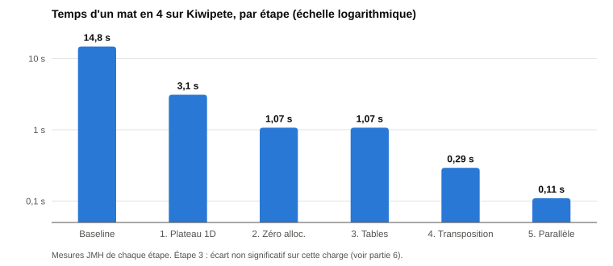
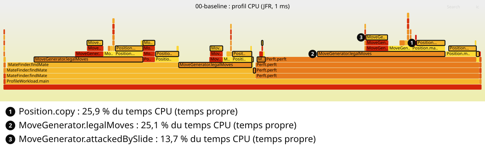
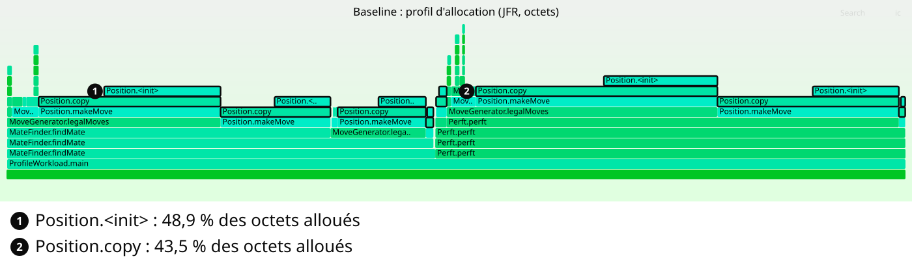
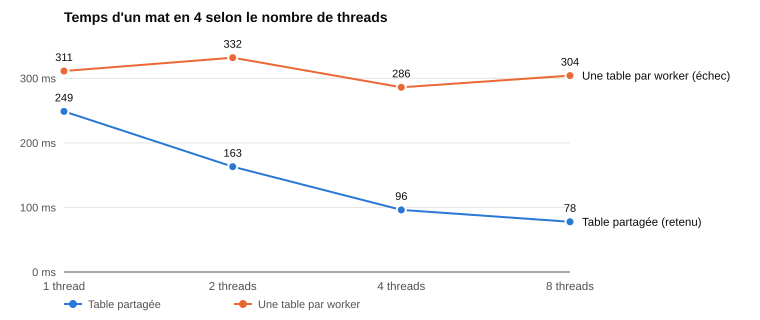
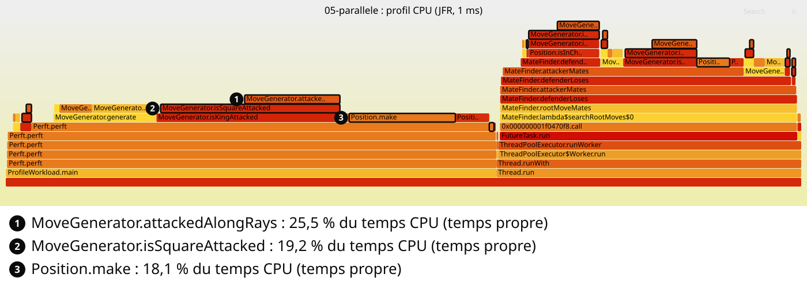

# Rapport d'audit de performance — ChessBot

Optimisation d'un solveur de mat en N écrit volontairement de façon naïve en Java. Chaque optimisation est **justifiée par une mesure**, appliquée dans **un commit dédié** (tag Git), puis **mesurée avant/après** sur les mêmes charges.

## 1. Synthèse

| # | Optimisation | Justification (mesure) | perft 4 | Mat en 3 | Mat en 4 | Alloc. / perft 4 |
|---|---|---|---|---|---|---|
| 0 | Baseline | — | 329,5 ms | 236,6 ms | 14,8 s | 258,8 Mo |
| 1 | Plateau 1D contigu | `Position.copy` : 26 % du CPU, 92 % des allocations | 39,6 ms (−88 %) | 57,4 ms (−76 %) | 3,1 s (−79 %) | 86,7 Mo (−66 %) |
| 2 | Zéro allocation | `Position.copy` : encore 84 % des allocations | 15,5 ms (−61 %) | 23,5 ms (−59 %) | 1,07 s (−66 %) | 54 o (−100 %) |
| 3 | Tables précalculées + roi mémorisé | détection d'échec : 54 % du CPU | −16 % (A/B) | −25 % (A/B) | non concluant | 60 o |
| 4 | Table de transposition | 78 % des nœuds du mat en 4 déjà analysés | +12 % (A/B, coût du hachage) | −40 % (A/B) | 0,29 s (−73 %) | 60 o |
| 5 | Recherche parallèle, table partagée | JVM à 12 % du CPU (1 thread sur 8) | — (non parallélisé) | 4,48 ms (−61 %) | 0,11 s (−63 %) | 73 o |
| ✗ | *Une table par worker (échec)* | *idem* | — | — | *−2 %, travail CPU +319 %* | — |
| ✗ | *Réordonner les champs (sans effet)* | *exploratoire* | *aucun effet mesurable (JOL)* | | | |
| **Total** | **Baseline → final** | | **−93,6 %** | **−98,1 %** | **−99,3 %** | **−100 %** |

*Temps moyens JMH. Variation = (après − avant) / avant, par rapport à l'étape précédente : −50 % = deux fois plus rapide. Mat en 5 : 41,9 s après l'optimisation 3, **1,5 s** en version finale. Latence perft 3, p99 : 54,8 → 1,8 ms (−96,7 %).*



## 2. Banc d'essai et protocole

- **Machine** : Intel Core i5-8300H (4 cœurs physiques, 8 threads, 2,3 GHz), 8 Go de RAM, Windows 11, portable sur secteur. JDK Temurin 25.0.4.
- **Mesure** : [JMH 1.37](src/test/java/com/chessbot/bench/ChessBenchmark.java) (équivalent Java de `go test -bench` + `benchstat`) : 3 JVM séparées, 3 itérations de chauffe, 5 itérations mesurées de 2 s, intervalle de confiance à 99,9 %. Hyperfine, qui chronomètre un processus entier, n'a pas été retenu : il mesurerait surtout le démarrage de la JVM et la compilation JIT, pas le code optimisé.
- **Bruit** : la machine est un portable dont la fréquence baisse quand il chauffe. Quand l'écart attendu est faible (optimisations 3 et 4), les deux versions sont mesurées **en alternance** (A, B, A, B, A, B) pour subir les mêmes conditions.
- **Allocations** : profileur `-prof gc` de JMH. **Profils** : JFR (échantillonnage CPU à 1 ms et allocations), convertis en flamegraphs ; résumés dans [docs/profiles](docs/profiles).
- **Non-régression** : [tests perft](src/test/java/com/chessbot/PerftTest.java) (nombres de positions de référence) et [tests de mat](src/test/java/com/chessbot/MateFinderTest.java) à chaque étape.

| Charge | Ce qu'elle mesure |
|---|---|
| `perft4` | génération de coups seule : les 197 281 positions à 4 demi-coups du départ |
| `perft3Latency` | distribution des temps (p50, p99) d'un perft 3 |
| `mateIn3`, `mateIn4` | recherche complète d'un mat en 3 et en 4 sur la position Kiwipete (aucun mat : tout est exploré) |

**Reproduire en une commande** : `./run_benchmarks.sh` ([script](run_benchmarks.sh), ~25 min, `--quick` en 5 min). **Vérifier les chiffres** : [tools/verify_report.py](tools/verify_report.py) recalcule chaque valeur du rapport depuis les résultats bruts de [docs/results](docs/results) et [docs/profiles](docs/profiles). **Mesures complètes** (intervalles de confiance, manches A/B, profil et flamegraph de chaque étape) : [version détaillée](RAPPORT-DETAILLE.pdf).

## 3. Baseline et point chaud

Tag [`baseline`](../../tree/baseline). Plateau `char[8][8]` copié à chaque coup testé, `ArrayList<Move>` créée à chaque nœud, légalité vérifiée en jouant le coup sur une copie, roi cherché sur les 64 cases à chaque test d'échec.

| Charge | Temps | Allocations |
|---|---|---|
| perft 4 | 329,5 ms | 258,8 Mo / op |
| perft 3 | p50 10,7 ms, p99 54,8 ms | 11,7 Mo / op |
| Mat en 3 | 236,6 ms | 254,8 Mo / op |
| Mat en 4 | 14,8 s | **15,5 Go / op** |

**Point chaud identifié.** La copie de position domine les deux profils : `Position.copy` prend **25,9 %** du temps CPU, et avec le constructeur de `Position` elle produit **92,4 % des octets alloués** (environ 1 Go/s, d'où une pression continue sur le GC). Juste derrière, `legalMoves` (25,1 %) teste la légalité de chaque coup en le jouant sur une nouvelle copie : le coût de la copie est payé pour chaque coup *candidat*, pas seulement pour chaque coup joué.





## 4. Optimisation 1 : plateau 1D contigu — *localité mémoire, lignes de cache 64 o*

**Constat.** `Position.copy` : 25,9 % du CPU et, avec le constructeur, 92,4 % des allocations.

**Technique.** En Java, `char[8][8]` est un tableau de 8 références vers 8 petits tableaux dispersés : chaque copie coûtait 17 allocations (dont 8 rangées créées puis aussitôt jetées) et deux accès mémoire par case. Un seul `char[64]` indexé par `ligne * 8 + colonne` ramène la copie à 2 allocations contiguës et un accès par case.

```java
final char[] board;                         // avant : final char[][] board = new char[8][8];
Position p = new Position(board.clone());   // avant : 8 appels à board[r].clone()
```

| Charge | Avant | Après | Variation |
|---|---|---|---|
| perft 4 | 329,5 ms | **39,6 ms** | **−88 %** |
| perft 3 p50 / p99 | 10,7 / 54,8 ms | 1,42 / 3,33 ms | −87 % / −94 % |
| Mat en 3 | 236,6 ms | **57,4 ms** | **−76 %** |
| Mat en 4 | 14,8 s | **3,1 s** | **−79 %** |
| Allocations perft 4 | 258,8 Mo | 86,7 Mo | −66 % |

**Analyse.** Le temps baisse plus que les octets alloués : passer de 17 à 2 allocations supprime aussi la mise à zéro de 9 tableaux et les accès indirects. Le p99 baisse plus que la médiane, car le GC a moins d'objets à traiter.

## 5. Optimisation 2 : zéro allocation — *pile vs tas, buffers préalloués (Module 3)*

**Constat.** La copie produit encore **84,4 %** des allocations : 86,7 Mo par perft 4, 5,2 Go par mat en 4.

**Technique.** Les positions et les listes de coups sont retournées ou stockées : elles s'échappent sur le tas, l'escape analysis ne peut rien. On les supprime :
- `make(move)` modifie la position en place, `unmake(move)` la restaure depuis une petite pile d'annulation préallouée ;
- les coups sont encodés dans un `int`, rangés dans un tableau `int[320]` par profondeur, créé une fois par thread et réutilisé.

```java
p.make(buffer[i]);                                  // avant : Position next = p.makeMove(m);
if (!MoveGenerator.isKingAttacked(p, !p.whiteToMove)) nodes += perft(p, moves, depth - 1, ply + 1);
p.unmake(buffer[i]);
```

**Diagnostic d'échappement.** La première version allouait encore plusieurs mégaoctets par mat en 3. JFR a désigné la source : `new int[]{-1, 1}` dans la génération des coups de pion. Ce tableau ne sort pas de la fonction, mais l'escape analysis de C2 ne l'a pas éliminé ; une constante `static final` l'a supprimé.

| Charge | Avant | Après | Variation |
|---|---|---|---|
| perft 4 | 39,6 ms | **15,5 ms** | **−61 %** |
| perft 3 p50 / p99 | 1,42 / 3,33 ms | 0,82 / 1,95 ms | −43 % / −41 % |
| Mat en 3 | 57,4 ms | **23,5 ms** | **−59 %** |
| Mat en 4 | 3,1 s | **1,07 s** | **−66 %** |
| Allocations perft 4 / mat en 4 | 86,7 Mo / 5,2 Go | **54 o / 6,8 Ko** | −100 % |

**Analyse.** Plus aucun GC pendant les mesures, et des intervalles de confiance réduits de plus de 90 % (perft 4 : ±8,3 → ±0,3 ms) : une partie du bruit venait des allocations elles-mêmes.

## 6. Optimisation 3 : tables précalculées + roi mémorisé — *compromis espace-temps (Module 1)*

**Constat.** La détection d'échec (`isKingAttacked`) représente **54,2 %** du temps CPU, dont 9,7 % passés à chercher le roi case par case.

**Technique.** Calculer une fois au démarrage (~30 Ko) tout ce qui ne dépend que de la case : cibles du cavalier et du roi, rayons des tours et des fous, attaques des pions. Le chemin critique ne fait plus de test de bord. La position des rois est mémorisée et mise à jour par `make` / `unmake` : recherche du roi en O(1) au lieu de O(64).

| Charge (A/B alterné, médianes) | Avant | Après | Variation |
|---|---|---|---|
| perft 4 | 15,9 ms | **13,4 ms** | **−16 %** |
| perft 3 | 826 µs | **530 µs** | **−36 %** |
| Mat en 3 | 21,5 ms | **16,0 ms** | **−25 %** |

**Analyse.** La nouvelle version est plus rapide dans chaque manche et sur chaque charge. Le gain est modeste : on a supprimé des calculs, mais le nombre de cases lues reste le même, et la détection d'échec domine encore (49,7 % du CPU). Sur le mat en 4, l'écart est non significatif (1,07 s dans les deux cas, seulement 3 mesures).

## 7. Optimisation 4 : table de transposition — *mémoïsation (Module 1), cache borné (Module 8)*

**Constat.** Chaque position coûte moins cher, mais leur nombre explose : le mat en 5 prend encore 41,9 s. Un [diagnostic](src/test/java/com/chessbot/TranspositionDiagnostic.java) compte les nœuds déjà analysés ailleurs dans l'arbre ([résultats](docs/results/04-transpositions.txt)) :

| Recherche | Nœuds visités | Distincts | Déjà analysés |
|---|---|---|---|
| Mat en 3 | 2 406 | 1 328 | **44,8 %** |
| Mat en 4 | 116 067 | 25 133 | **78,3 %** |

**Technique.** Des ordres de coups différents mènent à la même position. Chaque position reçoit une empreinte de 64 bits (**hachage Zobrist**, mise à jour en quelques XOR par `make`), et une [table](src/main/java/com/chessbot/MateTable.java) mémorise « mat forcé en n : oui / non ». La table a une **taille fixe** (2²⁰ entrées) : la mémoire ne grandit jamais. Deux tests vérifient que l'empreinte incrémentale égale un recalcul complet, et que le verdict est identique avec et sans table.

| Charge (A/B alterné, médianes) | Avant | Après | Variation |
|---|---|---|---|
| Mat en 3 | 21,6 ms | **12,9 ms** | **−40 %** |
| Mat en 4 (JMH) | 1,07 s | **0,29 s** | **−73 %** |
| Mat en 5 | 41,9 s | **4,6 s** | **−89 %** |
| perft 4 | 17,5 ms | 19,7 ms | **+12 %** |

**Analyse.** Le gain grandit avec la profondeur, comme la part de positions redondantes : c'est une baisse du **nombre** d'opérations. Contrepartie mesurée : perft, qui n'utilise pas la table, ralentit de 12 % car `make` met à jour l'empreinte à chaque coup (`Position.make` passe de 10,5 % à 18,0 % du CPU). Compromis accepté : le programme sert à chercher des mats.

## 8. Optimisation 5 : recherche parallèle — *worker pool borné, atomique, arrêt précoce (Modules 5 et 6)*

**Constat.** JFR mesure une charge CPU de la JVM de **12,2 %** : 1 thread logique sur 8, le reste du processeur est inutilisé.

**Technique.** Les coups de départ sont répartis sur un **pool de threads de taille fixe**, créé une fois. Chaque worker a ses propres buffers, et tous partagent **une seule table de transposition sans verrou** : chaque case stocke `empreinte ^ donnée` et `donnée`, et une écriture concurrente à moitié lue ne redonne pas l'empreinte, donc l'entrée est ignorée (extension de la règle du cours « privilégier l'atome au verrou »). Le résultat reste déterministe, et un drapeau `AtomicBoolean`, testé à chaque coup, arrête les autres workers dès que la réponse est connue (équivalent de `ctx.Done()`).

| Threads | Mat en 4 | Variation vs 1 thread | Mat en 5 | Variation vs 1 thread |
|---|---|---|---|---|
| 1 | 248,6 ms | 0 % | 4,32 s | 0 % |
| 2 | 163,0 ms | −34 % | 2,51 s | −42 % |
| 4 | 96,2 ms | −61 % | 1,68 s | −61 % |
| 8 | **77,7 ms** | **−69 %** | **1,53 s** | **−65 %** |



**Analyse (loi d'Amdahl).** Avec 4 threads, l'accélération de 2,58 correspond à une fraction parallélisable **P ≈ 82 %** ; la loi prédit alors au mieux −72 % avec 8 vrais cœurs, on mesure −69 %. Les 18 % restants viennent du déséquilibre de charge (certains coups de départ demandent beaucoup plus de travail) et de positions analysées en même temps par deux workers.

**Nombre de workers : la règle du cours confrontée à la mesure.** Pour un calcul pur, le cours fixe le nombre de workers au nombre de **cœurs physiques**, ici 4 (Module 6 §4). La mesure contredit cette règle sur cette machine : passer de 4 à 8 workers réduit encore le temps de **19 %** (17 % dans la mesure finale). Explication probable : la recherche attend souvent la mémoire (table de 16 Mo, plus grande que le cache L3), et l'hyper-threading occupe le cœur pendant ces attentes ; aucun verrou, donc pas de contention. Le pool est donc dimensionné sur les 8 threads logiques, choix justifié par la mesure.

## 9. Échec constructif : une table de transposition par worker

**Hypothèse.** Le cours recommande, pour répartir un calcul, un « traitement isolé sans partage de mémoire ni verrou » (Module 6 §5). Première version de l'optimisation 5 : chaque worker avait **sa propre table**.

**Mesure.** Aucun gain : mat en 4 en 311 ms avec 1 thread, 304 ms avec 8 (−2 %). Un [diagnostic](src/test/java/com/chessbot/bench/ParallelDiagnostic.java) mesure le temps CPU total du processus pendant un mat en 5 :

| Threads | Temps réel | Cœurs occupés | Travail CPU total |
|---|---|---|---|
| 1 | 5,68 s | 1,05 | référence |
| 8 | 4,25 s (−25 %) | 5,86 | **+319 %** |

**Analyse.** Les cœurs travaillent, mais le travail total augmente de 319 % : chaque worker refait les positions déjà analysées par les autres. 78 % des nœuds sont des transpositions (partie 7) ; isoler les tables détruit ce gain. Ce n'est pas de la contention au sens de la loi USL (Module 5 §7), puisqu'il n'y a aucun verrou : c'est du **travail fait en double**, et le remède est de partager les résultats. **Retour arrière** : version conservée sous le tag [`essai-parallele-tables-privees`](../../tree/essai-parallele-tables-privees), remplacée par la table partagée (travail total +56 % seulement, temps −69 %).

## 10. Essai sans effet : réordonner les champs — *struct padding (Module 3)*

Essai exploratoire d'une technique du cours : en Go, trier les champs d'une structure par taille décroissante supprime le padding (`CandidateBad` 40 octets → `CandidateGood` 32 octets). [JOL](src/test/java/com/chessbot/FieldLayoutDiagnostic.java) (équivalent Java de `fieldalignment`) montre que c'est sans effet en Java :

| Classe | Go (cours) | Java (JOL) |
|---|---|---|
| `CandidateBad` / `CandidateGood` | 40 / 32 octets | **32 / 32 octets**, disposition identique |
| `Position`, ordre d'origine / champs triés | — | **64 / 64 octets**, mêmes offsets |

La JVM HotSpot réorganise elle-même les champs au chargement de la classe : l'ordre du code source n'a aucune influence, et `Position` occupe déjà exactement une ligne de cache. Changement non conservé.

## 11. Axe « I/O réseau et persistance » : non applicable

Le solveur est un **calcul pur en mémoire** : ni fichier, ni réseau, ni base de données. À chaque étape, plus de 99 % des échantillons CPU sont dans le code de calcul. Optimiser un serveur ou une base ajoutés pour l'occasion aurait été artificiel. La partie **mise en cache** de cet axe est couverte par la table de transposition (partie 7), qui suit les principes d'un cache borné : taille fixe, remplacement en O(1), invalidation en O(1), gain mesuré.

## 12. Conclusion

De la baseline à la version finale, perft 4 baisse de 93,6 %, le mat en 4 de 99,3 % et les allocations d'environ 100 % (tableau de synthèse, partie 1). Les optimisations de structure de données et de mémoire (1 et 2) ont réduit le coût de chaque position d'environ 95 % et supprimé le travail du GC. L'algorithme et le parallélisme (4 et 5) ont réduit le *nombre* de positions et réparti le travail : ce sont eux qui font passer le mat en 5 de 41,9 s à 1,5 s. Dans le profil final, la détection d'échec reste le point chaud (44,8 % du CPU) :



**Pistes non réalisées** : ordonner les coups (échecs d'abord) pour trouver les mats plus tôt ; répartir le travail plus finement que par coup de départ pour réduire le déséquilibre de charge.
