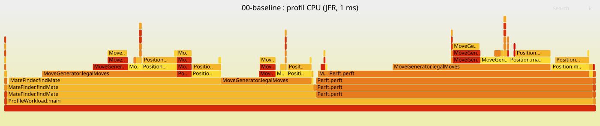

# Rapport d'audit de performance — ChessBot

Optimisation d'un solveur de mat en N écrit volontairement de façon naïve en Java.
Chaque optimisation est **justifiée par une mesure**, appliquée dans **un commit dédié** (tag Git), puis **mesurée avant/après** sur les mêmes charges.

## Synthèse

| # | Optimisation | Justification (mesure) | perft 4 | Mat en 3 | Mat en 4 | Alloc. / perft 4 |
|---|---|---|---|---|---|---|
| 0 | Baseline | — | 329,5 ms | 236,6 ms | 14,8 s | 258,8 Mo |
| 1 | Plateau 1D contigu | `Position.copy` : 28 % du CPU, 93 % des allocations | 39,6 ms (×8,3) | 57,4 ms (×4,1) | 3,1 s (×4,7) | 86,7 Mo |
| 2 | Zéro allocation (jouer/annuler, buffers) | `Position.copy` : encore 84 % des allocations | 15,5 ms (×2,6) | 23,5 ms (×2,4) | 1,07 s (×2,9) | 54 o |

*Temps moyens JMH, intervalle de confiance à 99,9 %. Gain = temps avant / temps après.*

## Protocole de mesure

- **Machine** : Intel Core i5-8300H (4 cœurs / 8 threads, 2,3 GHz), 8 Go RAM, Windows 11, portable sur secteur. JDK Temurin 25.0.4.
- **Banc d'essai** : [JMH 1.37](src/test/java/com/chessbot/bench/ChessBenchmark.java) (équivalent Java de `testing.B` + `benchstat`) : 3 JVM séparées (forks), 3 itérations de chauffe JIT, 5 itérations mesurées de 2 s, tas fixé à 2 Go. Le résultat des fonctions est renvoyé à JMH (Blackhole) pour éviter l'élimination de code mort.
- **Validité statistique** : JMH donne un intervalle de confiance à 99,9 % ; un gain est retenu seulement si les intervalles avant/après ne se recouvrent pas.
- **Allocations** : profileur `-prof gc` de JMH (octets alloués par opération, nombre de GC).
- **Profils CPU** : JFR (Java Flight Recorder) sur la [charge de profilage](src/test/java/com/chessbot/bench/ProfileWorkload.java), converti en flamegraph par [tools/JfrToFlame.java](tools/JfrToFlame.java) + `flamegraph.pl`.
- **Non-régression** : les [tests perft](src/test/java/com/chessbot/PerftTest.java) (nombres de positions de référence de chessprogramming.org) et les [tests de mat](src/test/java/com/chessbot/MateFinderTest.java) passent à chaque étape. Une optimisation qui casse un résultat n'est pas retenue.

| Charge | Ce qu'elle mesure |
|---|---|
| `perft4` | génération de coups seule : les 197 281 positions à 4 demi-coups de la position initiale |
| `perft3Latency` | distribution des temps (p50 / p99) d'un perft 3 |
| `mateIn3` | recherche complète de mat en 3 sur la position Kiwipete (aucun mat : rien n'est élagué tôt) |
| `mateIn4` | même recherche, un coup plus profond (mesure en coups uniques, car longue) |

Reproduire : `mvn -Dbuild.dir=target-bench clean test-compile exec:exec@bench -Djmh.args="-prof gc"` et `... exec:exec@profile`.

**Piège rencontré** : l'extension Java de VS Code compile elle aussi dans `target/` et écrasait par moments les classes mesurées (un benchmark a échoué avec « Unresolved compilation problems », message du compilateur Eclipse). Depuis l'optimisation 2, les mesures sont compilées dans un dossier séparé (`target-bench/`).

---

## 0. Baseline

Tag [`baseline`](../../tree/baseline). Code naïf : plateau `char[8][8]` copié à chaque coup testé, `ArrayList<Move>` créée à chaque nœud, légalité vérifiée en jouant le coup sur une copie, roi cherché sur les 64 cases à chaque test d'échec.

| Charge | Temps | Allocations |
|---|---|---|
| perft 4 | 329,5 ± 120,7 ms | 258,8 Mo / op |
| perft 3 (latence) | p50 10,7 ms · p99 54,8 ms · p99,9 177,9 ms | 11,7 Mo / op |
| Mat en 3 | 236,6 ± 35,3 ms | 254,8 Mo / op |
| Mat en 4 | 14,8 s (3 mesures : 14,9 / 14,1 / 15,3 s) | **15,5 Go / op** |

Débit d'allocation : environ **1 Go/s** en continu. Résultats bruts : [docs/results/00-baseline.txt](docs/results/00-baseline.txt).

**Profil CPU** ([flamegraph](docs/flamegraphs/00-baseline.svg), 2 552 échantillons JFR à 1 ms) :

| Temps propre | Méthode |
|---|---|
| 28,2 % | `Position.copy` |
| 20,3 % | `MoveGenerator.legalMoves` |
| 19,4 % | `MoveGenerator.attackedBySlide` |
| 3,0 % | `Position.<init>` |

**Profil d'allocation** (JFR) : `Position.<init>` 48,2 % + `Position.copy` 45,4 % = **93,5 % de toutes les allocations**.

**Remarque sur le bruit** : les itérations varient jusqu'à ×2 (perft 4 : de 211 à 572 ms) alors que le GC ne prend que 64 ms sur 30 s de mesure. Ce bruit vient de la machine (portable, turbo CPU, tâches de fond Windows) ; il élargit les intervalles de confiance mais reste bien inférieur aux gains mesurés ensuite.



---

## 1. Plateau 1D contigu — *localité mémoire (J1_PM)*

Tag [`opt1-plateau-1d`](../../tree/opt1-plateau-1d).

**Constat.** Dans la baseline, `Position.copy` est la méthode la plus coûteuse du profil CPU (28,2 % de temps propre) et, avec le constructeur de `Position`, elle produit **93,5 % des allocations**.

**Cause racine.** En Java, `char[8][8]` n'est pas un bloc : c'est un tableau de 8 références vers 8 petits tableaux dispersés sur le tas. Chaque copie de position coûtait donc **17 allocations et 592 octets** : l'initialiseur `new char[8][8]` créait 9 tableaux, dont les 8 rangées étaient aussitôt jetées et remplacées par 8 clones. Lire une case demandait en plus deux accès mémoire dépendants (référence de la rangée, puis la case).

**Technique.** Un seul tableau `char[64]` indexé par `ligne * 8 + colonne` : une copie = **2 allocations, 176 octets**, un seul `clone()` contigu ; une case = un seul accès mémoire. Le reste du code (génération de coups, recherche) est inchangé.

```java
final char[] board;                         // avant : final char[][] board = new char[8][8];
static int sq(int row, int col) { return row * 8 + col; }
Position p = new Position(board.clone());   // avant : 8 appels à board[r].clone()
```

**Résultat.**

| Charge | Avant | Après | Gain |
|---|---|---|---|
| perft 4 | 329,5 ± 120,7 ms | **39,6 ± 8,3 ms** | **×8,3** |
| perft 3 p50 / p99 | 10,7 / 54,8 ms | **1,42 / 3,33 ms** | ×7,6 / **×16** |
| Mat en 3 | 236,6 ± 35,3 ms | **57,4 ± 15,2 ms** | **×4,1** |
| Mat en 4 | 14,8 s | **3,1 s** (3,3 / 3,1 / 2,9) | **×4,7** |
| Allocations perft 4 | 258,8 Mo/op | 86,7 Mo/op | −66 % |

Les intervalles de confiance ne se recouvrent sur aucune charge : le gain est significatif.

**Analyse.** Le gain (×8) dépasse la seule baisse des octets alloués (÷3) : passer de 17 à 2 allocations par coup évite aussi la mise à zéro de 9 tableaux, 8 appels de copie séparés et les accès indirects. On ne peut pas séparer précisément ces effets, qui viennent tous de la même structure de données. La queue de latence (p99) baisse encore plus que la médiane, car le GC a 3 fois moins d'objets à traiter.

**Nouveau profil** ([flamegraph](docs/flamegraphs/01-plateau-1d.svg)) : la copie ne pèse plus que 0,4 % du CPU mais reste **83,9 % des allocations** (justifie l'optimisation 2). Le nouveau point chaud est la détection d'échec : `attackedBySlide` 34,8 % de temps propre, `isKingAttacked` 34,2 % du temps total (justifie l'optimisation 3).

---

## 2. Zéro allocation — *pile vs tas, buffers préalloués (J2_AM)*

Tag [`opt2-zero-allocation`](../../tree/opt2-zero-allocation).

**Constat.** Après l'optimisation 1, le profil JFR montre que `Position.copy` produit encore **83,9 % des allocations** : 86,7 Mo par perft 4, 5,2 Go par mat en 4.

**Cause racine.** Chaque coup *testé* (pas seulement joué) crée une nouvelle `Position`, et chaque nœud crée une `ArrayList<Move>` remplie d'objets `Move`. Tous ces objets sortent de la fonction qui les crée (ils sont retournés ou stockés dans une liste) : l'escape analysis du JIT ne peut pas les garder sur la pile.

**Technique.**
- **Jouer / annuler sur un seul plateau** : `make(move)` modifie la position en place et `unmake(move)` la restaure à partir d'une petite pile d'annulation préallouée (pièce capturée, droits de roque, case en passant).
- **Coups encodés en `int`** (case de départ, case d'arrivée, promotion sur 15 bits) au lieu d'objets `Move`.
- **Buffers préalloués** : un tableau `int[320]` par profondeur, créé une seule fois par thread et réutilisé à chaque appel (`ThreadLocal`), à la place des `ArrayList`.

```java
for (int i = 0; i < count; i++) {
    p.make(buffer[i]);                                   // avant : Position next = p.makeMove(m);
    if (!MoveGenerator.isKingAttacked(p, !p.whiteToMove))
        nodes += perft(p, moves, depth - 1, ply + 1);
    p.unmake(buffer[i]);
}
```

**Diagnostic d'échappement en cours de route.** La première version de l'optimisation allouait encore **21,7 Mo par mat en 3**. JFR a désigné la source : 99 % des allocations restantes venaient de `for (int dc : new int[]{-1, 1})` dans la génération des coups de pion. Ce tableau littéral ne sort pourtant jamais de la fonction, mais l'escape analysis de C2 ne l'a pas éliminé dans ce contexte. Le remplacer par une constante `static final` a supprimé ces allocations. Leçon : l'escape analysis n'est pas une garantie, il faut vérifier par la mesure (équivalent de `go build -gcflags="-m"`).

**Résultat** (avant = optimisation 1).

| Charge | Avant | Après | Gain |
|---|---|---|---|
| perft 4 | 39,6 ± 8,3 ms | **15,5 ± 0,3 ms** | **×2,6** |
| perft 3 p50 / p99 / p99,9 | 1,42 / 3,33 / 4,33 ms | **0,82 / 1,95 / 3,39 ms** | ×1,7 / ×1,7 / ×1,3 |
| Mat en 3 | 57,4 ± 15,2 ms | **23,5 ± 1,0 ms** | **×2,4** |
| Mat en 4 | 3,1 s | **1,07 s** (1,07 / 1,09 / 1,05) | **×2,9** |
| Allocations perft 4 | 86,7 Mo/op | **54 o/op** | −100 % |
| Allocations mat en 4 | 5,2 Go/op | **6,8 Ko/op** | −100 % |
| Nombre de GC pendant la mesure | 15 à 30 | **≈ 0** | |

Les quelques octets restants sont alloués une fois par appel hors du chemin critique (résultat `Optional<Move>`, infrastructure JMH). Les intervalles de confiance sont aussi **8 à 25 fois plus étroits** : une partie du bruit des mesures précédentes venait des allocations elles-mêmes.

**Nouveau profil** ([flamegraph](docs/flamegraphs/02-zero-allocation.svg)) : il ne reste aucune allocation applicative (les allocations visibles viennent de JFR lui-même). Le CPU est maintenant dominé par la détection d'échec : `attackedBySlide` **53,2 % de temps propre**, `isKingAttacked` **60,6 % du temps total**, dont 10,3 % de temps propre passé à **chercher le roi case par case** (justifie l'optimisation 3).
